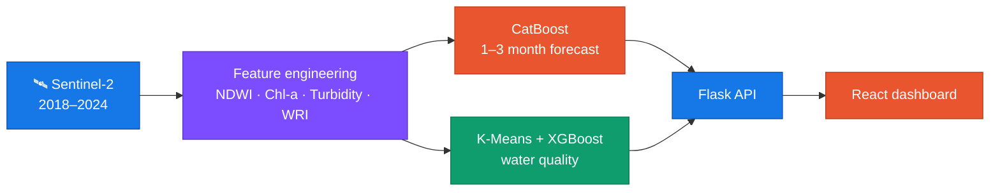

  

  
  
  

## 💫 About Me

I started with **web development**, building my foundation with HTML, CSS and JavaScript. Then I fell for **machine learning**: the idea that data and algorithms can learn patterns we can't see by eye.

Since then I've worked on image classification, time-series forecasting and, most recently, **AquaTrack**, a team project where we forecast lake water levels from satellite data. I led the team, trained the models and built the dashboard, and it took us to the finals of Turkcell's Geleceği Yazan Yapay Zekâ Kadınları program.

I enjoy the whole path from messy data to something people can open in a browser and use. Right now I'm learning how to make ML projects reliable in production: tests, Docker and CI/CD.

  
  

## 🌊 AquaTrack in one picture

## 🛠️ Tech Stack

  

> *"Every mistake is a step that makes you a better programmer."* 💫

